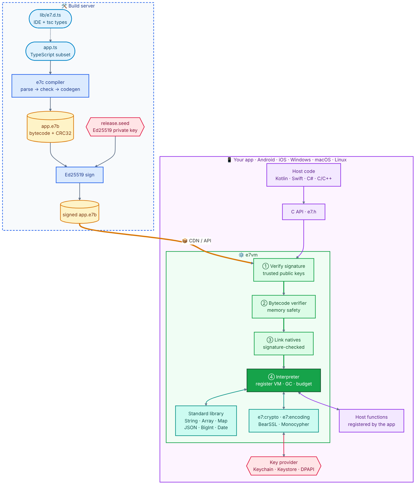

# e7vm — the E7 language and virtual machine

**English** | [简体中文](README.zh-CN.md)

**E7** is a **strictly, statically typed subset of TypeScript**: every valid E7 program is also a valid
TypeScript program. **e7vm** is a small embeddable bytecode VM written in C++17 for
**Android, iOS, Windows, macOS and Linux**. It runs **server-delivered scripts** inside your app, mainly
**request signing and signature verification**, plus general math and string algorithms. Scripts are
sandboxed, signed and fast.

```ts
// sign.ts: full type checking and completion in VS Code (via lib/e7.d.ts)
import { hmac } from "e7:crypto";
import { hexEncode } from "e7:encoding";
import type { KeyHandle } from "e7:crypto";

export function sign(params: Map<string, string>, key: KeyHandle): string {
  const query = [...params.keys()].sort()
    .map(k => `${encodeURIComponent(k)}=${encodeURIComponent(params.get(k)!)}`).join("&");
  return hexEncode(hmac("sha256", key, new TextEncoder().encode(query)));
}
```

> The name: `everettjf` = **e** + `verettj` (7 letters) + **f** → **e7f**, so the language is **E7**.

## Why e7vm

- **Ship algorithm updates without an app release.** Compile and sign on your server, deliver `.e7b` bytecode, and the app verifies and runs it.
- **Safe by construction.**
  - Ed25519 module signatures.
  - A bytecode verifier that guarantees memory safety even for tampered bytecode.
  - An instruction budget, memory limit and call-depth limit.
  - No JIT, which App Store rules require.
  - Scripts can only call the host functions you register.
- **Secrets stay in the host.** A `KeyHandle` lets scripts use a key held in the Keychain or Keystore without ever seeing the key bytes.
- **TypeScript you already know.** The same JS semantics, checked by `tsc --strict`, and differential-tested against Node.js.
- **Small and fast.**
  - About 470 KB for the runtime only, or about 920 KB with the on-device compiler.
  - Interpreter speed comparable to or faster than V8's interpreter (`--jitless`).
  - Standard crypto runs as native code.

## Architecture

<p align="center"></p>

| Layer | Where | What it does |
|---|---|---|
| Compiler | `src/compiler/` | Lexer and parser, strict type checker (narrowing, closures, classes, modules), register-allocating code generator |
| Bytecode | `src/core/` | `.e7b` format with CRC32, optional Ed25519 signature trailer, verifier, disassembler |
| VM | `src/vm/` | Register-based interpreter with 64-bit instructions, typed registers, inline caches, precise mark-sweep GC, budget/suspend |
| Standard library | `src/stdlib/`, `src/crypto/` | JS-compatible built-ins; crypto and encoding run as native code |
| Embedding | `src/capi/`, `platform/` | C API; Java/Kotlin (JNI), Swift, and C# bindings |

## Quick start

### 1. Build

Prerequisites: CMake ≥ 3.16 and a C++17 compiler (GCC, Clang, MSVC). Ninja is optional.

```bash
git clone https://github.com/everettjf/e7fvm.git && cd e7fvm
cmake -S . -B build -DCMAKE_BUILD_TYPE=Release
cmake --build build -j
```

This produces `build/e7` (run scripts), `build/e7c` (compile, sign and disassemble) and `build/libe7vm_static.a`.

### 2. Write and run a script

[`examples/embed/sign.ts`](examples/embed/sign.ts):

```ts
import { hmac } from "e7:crypto";
import { hexEncode } from "e7:encoding";

// Called by the host app: returns hex(HMAC-SHA256(secret, message))
export function sign(message: string, secret: string): string {
  const enc = new TextEncoder();
  return hexEncode(hmac("sha256", enc.encode(secret), enc.encode(message)));
}

export function main(): string {
  return sign("amount=100&currency=CNY", "s3cr3t");
}
```

```bash
cd examples/embed
../../build/e7 sign.ts
# 0fa1ee36e152de30350b6a463f4f365d6574bea59f99ccfebb599c7b6b1f1fd6
```

`e7` compiles the file in memory and calls the exported `main` (or the function named by `--call`).

### 3. Compile and sign for delivery

```bash
../../build/e7c --keygen release                  # release.seed (keep secret) + release.pub
../../build/e7c sign.ts -o sign.e7b --sign release.seed
../../build/e7 --trust release.pub sign.e7b       # runs only if signed by this key
../../build/e7c --disasm sign.ts                  # optional: inspect the bytecode
```

On a real deployment, `release.seed` lives only on your build server (or HSM), and `release.pub` is
compiled into the app.

### 4. Run it from your app

[`examples/embed/host.c`](examples/embed/host.c), trimmed:

```c
#include "e7/e7.h"

e7_config cfg;
e7_config_init(&cfg);
cfg.require_signature = 1;            /* only run modules signed by our key */
cfg.trusted_keys = pub;               /* 32-byte Ed25519 public key(s) baked into the app */
cfg.num_trusted_keys = 1;
cfg.memory_limit = 32u << 20;
e7_vm* vm = e7_vm_new(&cfg);

e7_module* mod;
if (e7_load(vm, code, len, &mod) != E7_OK) { puts(e7_last_error(vm)); return 1; }

e7_value args[2];
args[0].type = E7_STRING; args[0].v.str.ptr = "amount=100&currency=CNY"; args[0].v.str.len = 23;
args[1].type = E7_STRING; args[1].v.str.ptr = "s3cr3t";                  args[1].v.str.len = 6;
e7_value ret;
e7_set_budget(vm, 10000000);          /* stop runaway scripts */
if (e7_call(vm, mod, "sign", args, 2, &ret) == E7_OK)
  printf("%.*s\n", (int)ret.v.str.len, ret.v.str.ptr);
e7_vm_free(vm);
```

```bash
cc -std=c11 host.c -I../../include ../../build/libe7vm_static.a \
   ../../build/libe7_bearssl.a ../../build/libe7_monocypher.a -lstdc++ -lm -o host
./host
# 0fa1ee36e152de30350b6a463f4f365d6574bea59f99ccfebb599c7b6b1f1fd6
```

Kotlin, Swift and C# use the same flow: create the VM with the trusted key, call `load(bytes)`, then
`call("sign", ...)`. See [docs/EMBEDDING.md](docs/EMBEDDING.md) for each platform, plus host functions,
`KeyHandle`, budgets and time-slicing.

### 5. Editor setup

Add [`lib/e7.d.ts`](lib/e7.d.ts) to your `tsconfig.json` `files` to get completion and type errors in
VS Code. Running `tsc --strict` on your scripts gives the same diagnostics as `e7c`.

## Features

- **Language.**
  - Declarations and functions: `let`/`const`, functions, arrow functions and closures.
  - Classes: single inheritance, `super`, static members and parameter properties.
  - Types: interfaces, type aliases, enums and tuples.
  - Syntax: destructuring, object spread, `?.`, `??`/`??=`, template strings, `for...of`, `switch` and labels.
  - Multi-file `import`/`export`, and type narrowing.
- **Strict types.**
  - There is no `any`; nullable types use `T | null | undefined`.
  - All names and types are resolved at compile time.
- **Numbers like JavaScript.**
  - `number` is a 64-bit float.
  - Opt-in fixed-width integers `i8 … u64` wrap on overflow and run as real machine integers.
  - Single-instruction intrinsics such as `rotl32`, `clz32` and `mulhi64`.
- **Standard library.**
  - `Math`, `Number`, `String`, `Array` (`map`/`filter`/`reduce`/`sort` …), `Map`, `Set`, `bigint`, `Date` (UTC).
  - `JSON`: `JSON.parse(text) as T` **validates** the result against the type `T`.
  - `Uint8Array`/`ArrayBuffer`/`DataView`, `TextEncoder`/`TextDecoder`, `encodeURIComponent`.
- **`e7:crypto`.**
  - Hashes: MD5, SHA-1, SHA-2, SHA-3, Keccak.
  - Key derivation and MACs: HMAC, HKDF, PBKDF2.
  - Ciphers: AES-GCM/CBC/CTR, ChaCha20-Poly1305.
  - Signatures and key exchange: Ed25519, X25519, ECDSA P-256/384/521 (raw or strict DER), RSA PKCS#1 v1.5 and PSS.
  - Also CRC32, secure random bytes, and `KeyHandle`.
- **`e7:encoding`.** hex, base64, base64url, base32, UTF-8, PEM, plus byte concat and compare.
- **Execution control.**
  - The instruction budget also covers heavy native calls.
  - Optional suspend/resume (`e7_resume`) for time-slicing on the UI thread.
- **Bindings.** C API ([`include/e7/e7.h`](include/e7/e7.h)), Java/Kotlin (JNI), Swift, C#.

The full language reference is in [docs/SPEC.md](docs/SPEC.md).

## Platforms

| Platform | Build | Bindings |
|---|---|---|
| Linux / macOS | `cmake -S . -B build && cmake --build build && ctest --test-dir build` | C/C++ |
| Android | `ANDROID_NDK_HOME=... platform/android/build_android.sh` → `build-android/jniLibs/<abi>/libe7vm_jni.so` | Java/Kotlin: `platform/java/org/e7vm` |
| iOS | `platform/ios/build_xcframework.sh` → `build-ios/e7vm.xcframework` | Swift: `platform/ios/E7VM/E7VM.swift` |
| Windows | `platform/windows/build_windows.ps1 [-ClangCl] [-Shared]` (VS 2022) | C/C++, C#: `platform/windows/E7VM.cs` |

CMake options:

| Option | Effect |
|---|---|
| `E7_WITH_COMPILER` | On-device compiler (default ON) |
| `E7_BUILD_SHARED` | Build the shared library, which exports only the `e7_*` C API |
| `E7_BUILD_JNI` | Build the JNI library |
| `E7_SANITIZE` | ASan + UBSan |
| `E7_NO_COMPUTED_GOTO` | Use switch dispatch |

## Security and production readiness

e7vm is built for running code that comes over the network. Before release it went through four
independent security reviews, differential testing against Node.js/OpenSSL, sanitizers, and fuzzing,
and every finding was fixed with a regression test. The evidence is in
[docs/PRODUCTION.md](docs/PRODUCTION.md). The host must:

1. **Turn on signature checking** (`require_signature` plus the public key built into the app) and keep the private key on the build server.
2. **Set an instruction budget and a memory limit** (for example 16–64 MiB).
3. **Pass secrets as `KeyHandle`s**, never as string or byte arguments.

## Testing

```bash
python3 tests/run_tests.py     # language/library tests, byte-for-byte against Node.js + error cases
ctest --test-dir build         # all suites: C API, re-entrancy, malicious modules, fuzzers, locale
tests/tsc/check.sh             # every test and example type-checks with tsc --strict
```

CI ([`.github/workflows/ci.yml`](.github/workflows/ci.yml)) runs 15 jobs on every push:

- **Linux:** GCC, Clang 18, Clang 16, ASan+UBSan, switch dispatch, shared library, 32-bit.
- **macOS:** Release and ASan.
- **Mobile:** iOS, Android NDK, JNI.
- **Windows:** MSVC and clang-cl.
- **TypeScript:** `tsc` strict check.

## Performance

These numbers are from x86-64, Release build, in milliseconds (scripts in `bench/`). They compare
against Node.js 22, both V8's interpreter (`--jitless`, which is pure interpretation like e7vm and the
only option on iOS) and the full JIT.

| Benchmark | e7vm | V8 --jitless | V8 JIT |
|---|---:|---:|---:|
| fib(30), recursive calls | 58 | 70 | 10 |
| 30M-iteration loop (top-level globals) | 369 | 518 | 45 |
| Sieve of Eratosthenes, 5M | 298 | 465 | 91 |
| 4M allocations + 2M method calls | 395 | 739 | 38 |
| SHA-256 in pure script (u32), 1 MiB | 168 | 1159 | 41 |
| String concat/split/Map | 384 | 293 | 243 |

In signing scripts, standard algorithms (HMAC, RSA, ECDSA, …) run natively, so a typical call takes
well under a millisecond.

## Repository layout

```
include/e7/e7.h     C API                      lib/e7.d.ts      types for IDEs / tsc
src/compiler/       parser, type checker, codegen
src/core/           bytecode format, serializer, verifier, disassembler, JS number formatting
src/vm/             interpreter, object model, GC
src/stdlib/         built-ins                  src/crypto/      e7:crypto, module signatures
src/capi/           C API                      tools/           e7, e7c command-line tools
platform/           Android (JNI) / Java, iOS (Swift), Windows (C#)
examples/           sample scripts + embedding example (examples/embed)
tests/ bench/ docs/                            third_party/     BearSSL (MIT), Monocypher (BSD-2/CC0)
```

## Documentation

- [docs/SPEC.md](docs/SPEC.md): language specification (syntax, types, numeric semantics, standard library, differences from TS)
- [docs/EMBEDDING.md](docs/EMBEDDING.md): C API, Android/iOS/Windows integration, security guidance
- [docs/BYTECODE.md](docs/BYTECODE.md): `.e7b` format, instruction set, verification rules, signature format
- [docs/DESIGN.md](docs/DESIGN.md): design and decision record
- [docs/PRODUCTION.md](docs/PRODUCTION.md): production-readiness checklist with evidence

## License

See [LICENSE](LICENSE). Third-party code: BearSSL (MIT) and Monocypher (BSD-2-Clause / CC0), in `third_party/`.
