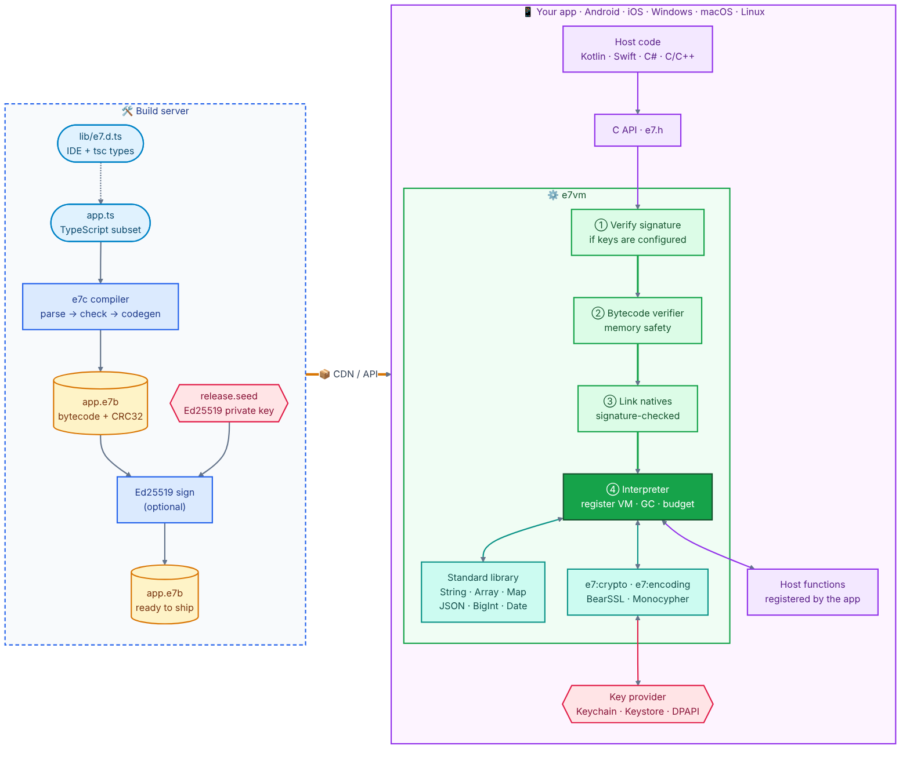

# e7vm — E7 语言与虚拟机

[](https://github.com/e7lang/e7/actions/workflows/ci.yml) [](https://github.com/e7lang/e7/releases/latest) [](LICENSE) [](https://e7lang.github.io/playground)

[English](README.md) | **简体中文** · 官网：[e7lang.github.io](https://e7lang.github.io) · [**在浏览器里试用**](https://e7lang.github.io/playground) · [下载](https://github.com/e7lang/e7/releases/latest)

**E7** 是一门**严格静态类型的 TypeScript 子集**：每个合法的 E7 程序同时也是合法的 TypeScript 程序。
**e7vm** 是用 C++17 实现的轻量嵌入式字节码虚拟机，支持 **Android、iOS、Windows、macOS、Linux**，
用于在 App 内执行**由服务器下发的脚本**：主要是**签名 / 验签**，也包括常规的数学与字符串算法。
脚本运行在沙箱里，速度快；需要时还可以给模块加签名。

```ts
// sign.ts：在 VS Code 里有完整的类型检查与补全（配合 lib/e7.d.ts）
// App 调用这个函数；更新时只需从服务器下发新脚本，无需发版。
import { hmac } from "e7:crypto";
import { hexEncode } from "e7:encoding";

export function sign(msg: string, key: string): string {
  const enc = new TextEncoder();
  const mac = hmac("sha256", enc.encode(key), enc.encode(msg));
  return hexEncode(mac);
}
```

> 名字来源：`everettjf` = **e** + `verettj`（7 个字母）+ **f** → **e7f**，语言因此取名 **E7**。

## 为什么用 e7vm

- **算法更新不必发版。** 服务器编译，下发 `.e7b` 字节码，App 校验后执行。
- **从设计上保证安全。**
  - 可选的 Ed25519 模块签名，用于脚本经过不可信网络传输的场景。
  - 字节码验证器保证内存安全，字节码被篡改也一样。
  - 指令预算、内存上限、调用深度上限。
  - 无 JIT，符合 App Store 的要求。
  - 脚本只能调用宿主显式注册的函数。
- **密钥留在宿主。** 通过 `KeyHandle`，脚本可以使用 Keychain / Keystore 里的密钥，但拿不到密钥本身。
- **就是你熟悉的 TypeScript。** 语义与 JS 一致，能通过 `tsc --strict`，并与 Node.js 做差分测试。
- **体积小、速度快。**
  - 仅运行时约 470 KB，含端上编译器约 920 KB。
  - 解释器速度与 V8 的解释器（`--jitless`）相当或更快。
  - 标准密码算法由原生代码执行。

## 架构

<p align="center">
  <picture>
    <source media="(prefers-color-scheme: dark)" srcset="docs/architecture-dark.png">
    
  </picture>
</p>

| 层 | 位置 | 职责 |
|---|---|---|
| 编译器 | `src/compiler/` | 词法/语法分析、严格类型检查（类型收窄、闭包、类、模块）、带寄存器分配的代码生成 |
| 字节码 | `src/core/` | `.e7b` 格式（CRC32，可附 Ed25519 签名）、验证器、反汇编 |
| 虚拟机 | `src/vm/` | 寄存器式解释器（64 位指令、类型化寄存器、内联缓存）、精确标记清除 GC、预算/挂起 |
| 标准库 | `src/stdlib/`、`src/crypto/` | 与 JS 兼容的内建对象；加密与编码由原生代码实现 |
| 嵌入 | `src/capi/`、`platform/` | C API；Java/Kotlin（JNI）、Swift、C# 绑定 |

## 快速上手

### 1. 安装或构建

**预编译版本：** 从 [最新 Release](https://github.com/e7lang/e7/releases/latest) 下载对应平台的 `e7-<版本>-<平台>`：
Linux（x64、arm64）、macOS（通用二进制）、Windows（x64）。压缩包内含 `bin/e7`、`bin/e7c`、`include/e7/e7.h`、
`lib/` 静态库、`types/e7.d.ts` 和示例。
每个发布文件和语言包（压缩包、`.nupkg`、`.aar`、`.jar`、`.tgz`、`.vsix`、skill zip）都带有 GitHub 构建来源证明：
`gh attestation verify e7-<版本>-<平台>.tar.gz --repo e7lang/e7` 可以验证它确实由本仓库的发布流程从对应标签构建。
每个 Release 还附有 SPDX 格式的 SBOM（`e7-<版本>.spdx.json`）。
**.NET：** `dotnet add package E7VM`（C# 绑定，内含 Windows、Linux、macOS 原生库）。
什么都不想装：[Playground](https://e7lang.github.io/playground) 直接在浏览器里运行编译器和虚拟机（WebAssembly）。
**Node.js / 浏览器：** `npm install @e7lang/e7`（[packages/e7](packages/e7)）是同一套编译器和虚拟机的 WebAssembly 版本，
提供 JavaScript API（`compile`、`check`、`run`、`disassemble`）和 `e7-js` 命令行（`npx -p @e7lang/e7 e7-js run sign.ts`）。

**从源码构建：** 需要 CMake ≥ 3.16 和支持 C++17 的编译器（GCC、Clang、MSVC），Ninja 可选。

```bash
git clone https://github.com/e7lang/e7.git && cd e7
cmake -S . -B build -DCMAKE_BUILD_TYPE=Release
cmake --build build -j
```

构建产物：`build/e7`（运行脚本）、`build/e7c`（编译、反汇编，可选签名）、`build/libe7vm_static.a`。

### 2. 编写并运行脚本

[`examples/embed/sign.ts`](examples/embed/sign.ts)：

```ts
import { hmac } from "e7:crypto";
import { hexEncode } from "e7:encoding";

// Called by the host app: returns hex(HMAC-SHA256(secret, message))
export function sign(msg: string, key: string): string {
  const enc = new TextEncoder();
  return hexEncode(hmac("sha256", enc.encode(secret), enc.encode(message)));
}

export function main(): string {
  return sign("amount=100&currency=CNY", "s3cr3t");
}
```

```bash
cd examples/embed
../../build/e7 sign.ts
# 0fa1ee36e152de30350b6a463f4f365d6574bea59f99ccfebb599c7b6b1f1fd6
```

`e7` 在内存中编译该文件，并调用导出的 `main`（或用 `--call` 指定的函数）。

### 3. 编译为字节码

```bash
../../build/e7c sign.ts -o sign.e7b               # 跨平台字节码：所有平台通用同一个文件
../../build/e7 sign.e7b                           # 运行
../../build/e7c --disasm sign.ts                  # 可选：查看字节码
```

`.e7b` 文件在任何能运行 e7vm 的地方都能跑，可以直接发给别人，或者下发给 App。

### 4. 可选：给模块签名

签名默认关闭。只有脚本经过你不完全信任的渠道传输时（比如 App 运行时从网络下载）才需要：
接收方可以借此拒绝一切不是你生成的模块。

```bash
../../build/e7c --keygen release                  # 生成 release.seed（私钥，保密）和 release.pub
../../build/e7c sign.ts -o sign.e7b --sign release.seed
../../build/e7 --trust release.pub sign.e7b       # 只运行该公钥签名的模块
```

不加 `--trust`（或 App 里没有配置受信公钥）时，签过名的模块和未签名的一样直接运行。

### 5. 在 App 中运行

[`examples/embed/host.c`](examples/embed/host.c)（节选）：

```c
#include "e7/e7.h"

e7_config cfg;
e7_config_init(&cfg);
cfg.memory_limit = 32u << 20;
/* 可选：只运行你签名的模块
   cfg.require_signature = 1; cfg.trusted_keys = pub; cfg.num_trusted_keys = 1; */
e7_vm* vm = e7_vm_new(&cfg);

e7_module* mod;
if (e7_load(vm, code, len, &mod) != E7_OK) { puts(e7_last_error(vm)); return 1; }

e7_value args[2];
args[0].type = E7_STRING; args[0].v.str.ptr = "amount=100&currency=CNY"; args[0].v.str.len = 23;
args[1].type = E7_STRING; args[1].v.str.ptr = "s3cr3t";                  args[1].v.str.len = 6;
e7_value ret;
e7_set_budget(vm, 10000000);          /* 防止失控脚本 */
if (e7_call(vm, mod, "sign", args, 2, &ret) == E7_OK)
  printf("%.*s\n", (int)ret.v.str.len, ret.v.str.ptr);
e7_vm_free(vm);
```

```bash
cc -std=c11 host.c -I../../include ../../build/libe7vm_static.a \
   ../../build/libe7_bearssl.a ../../build/libe7_monocypher.a -lstdc++ -lm -o host
./host
# 0fa1ee36e152de30350b6a463f4f365d6574bea59f99ccfebb599c7b6b1f1fd6
```

Kotlin、Swift、C# 的流程相同：创建 VM（可选地配置受信公钥），调用 `load(bytes)`，再 `call("sign", ...)`。
Swift 项目可直接通过 Swift Package Manager 引入：

```swift
// Package.swift：.package(url: "https://github.com/e7lang/e7.git", from: "0.2.5")
//                .product(name: "E7VM", package: "e7")
import E7VM

let vm = try E7VM()
let module = try vm.load(bytecode)  // sign.e7b 的内容
let mac = try vm.call(module, "sign", .string("amount=100&currency=CNY"), .string("s3cr3t"))
// .string("0fa1ee36e152de30350b6a463f4f365d6574bea59f99ccfebb599c7b6b1f1fd6")
```

Android 直接从 Maven 引入 AAR：

```kotlin
dependencies {
    implementation("org.e7vm:e7vm-android:0.2.5")   // 桌面 JVM 用 org.e7vm:e7vm:0.2.5
}
```

在发布到 Maven Central 之前，可以添加 GitHub Packages 仓库 `https://maven.pkg.github.com/e7lang/e7`
（需要带 `read:packages` 权限的 token，见 [docs/EMBEDDING.md](docs/EMBEDDING.md#31-gradle-dependency-recommended)），
或从 [Release 页面](https://github.com/e7lang/e7/releases/latest) 下载 `.aar`。

各平台的具体写法，以及宿主函数、`KeyHandle`、预算与分片执行，见 [docs/EMBEDDING.md](docs/EMBEDDING.md)。

### 6. 编辑器配置

把 [`lib/e7.d.ts`](lib/e7.d.ts) 加入 `tsconfig.json` 的 `files`，VS Code 里就有补全和类型报错。
对脚本运行 `tsc --strict`，得到的诊断与 `e7c` 一致。

VS Code 扩展 **E7 Language**（[editors/vscode](editors/vscode)，发布者 `e7lang`；每个 [Release](https://github.com/e7lang/e7/releases/latest)
都附带 `.vsix`）在输入时给出 E7 编译器自己的诊断，并提供 *E7: Run File*、*E7: Compile to Bytecode*、*E7: Show Bytecode* 命令。
它作用于 `*.e7` 文件、导入 `"e7:..."` 模块的 `.ts` 文件，以及匹配 `e7.files` 设置的文件。

### 7. 调试

`e7 debug script.ts` 是一个小型命令行调试器（`b file:line`、`c`、`n`、`s`、`finish`、`bt`、`locals`、
`p name.field`、`list`），执行到 `debugger;` 语句时会停下。宿主程序可通过 C 调试 API（`e7_debug_*`：断点、单步、
暂停、调用栈、可展开的变量）获得同样的能力，JavaScript 则通过 WebAssembly 构建的 JSON 协议使用
（`@e7lang/e7` 中的 `createDebugSession()`）。在 VS Code 中，E7 扩展可按 F5 调试 E7 文件：断点、单步、变量、
监视与悬停求值。用 `e7c --debug` 编译可在 `.e7b` 中保留变量名和列号，运行时错误随之报告
`at f (file.ts:12:5)`。详见 [docs/DEBUGGING.md](docs/DEBUGGING.md)。

## 用 AI 助手编写 E7

E7 看起来像 TypeScript，AI 助手很容易写出 E7 不支持的 TypeScript（`finally`、泛型、`any`、正则、联合类型等）。
**E7 skill**（[`skills/e7`](skills/e7)）会告诉 AI：E7 支持什么、不支持的写法该怎么改、标准库有哪些，以及每次都要用
`e7c --check` 编译检查。在我们的测试中，它把结果正确率从 88% 提升到 100%，每个任务的耗时减少约 40%。

- **Claude Code**：`/plugin marketplace add e7lang/e7`，然后 `/plugin install e7@e7lang`
  （Claude Code 2.1.275 及以上也可以直接 `/plugin install e7 --marketplace e7lang/e7`）。
  不用插件系统的话：把 `skills/e7` 复制到 `~/.claude/skills/e7`（或项目里的 `.claude/skills/e7`）。
- **claude.ai / Claude API / 其他工具**：使用 [最新 Release](https://github.com/e7lang/e7/releases/latest) 里的 `e7-skill.zip`。
- **能读取网页的 AI 助手**：让它读取 [e7lang.github.io/llms.txt](https://e7lang.github.io/llms.txt)，
  或全文 [llms-full.txt](https://e7lang.github.io/llms-full.txt)。

skill 里的每个代码示例都会在 CI 中实际编译运行，因此它不会和语言本身脱节。

## 测试你的脚本

把测试写在 `*.test.ts` 文件里，导出名字以 `test` 开头的函数，并使用内置模块 `e7:test` 提供的断言
（示例见 [`examples/tests/`](examples/tests/)）：

```ts
import { assert, assertEqual, assertThrows } from "e7:test";
import { totalOf, discountPercent } from "./pricing.ts";

export function testDiscountCodes(): void {
  assertEqual(discountPercent(" welcome10 "), 10);
  assertEqual(totalOf([{ sku: "pen", unitCents: 199, qty: 3 }], null).total, 597);
}

export function testUnknownCodeIsRejected(): void {
  assertThrows(() => { discountPercent("FREE"); }, "unknown discount code");
}
```

```bash
build/e7 test                    # 运行当前目录下所有 **/*.test.ts
build/e7 test examples/tests --filter Discount
```

```
✓ examples/tests/pricing.test.ts › testDiscountCodesAreCaseInsensitive (0.2 ms)

1 passed, 0 failed (1 file, 2 ms)
```

- 每个测试都在**全新的 VM** 中运行，拥有独立的指令预算（`--budget`，默认 10^9）和内存上限（`--mem`，默认 128 MiB），
  测试之间互不影响；死循环会失败而不会卡住。
- 测试函数正常返回即通过（返回类型为 `boolean` 时需返回 `true`）。断言失败、`throw`、运行时错误、预算或内存耗尽都会使其失败；
  运行器会打印错误信息、调用栈以及该测试的输出。
- 断言：`assert`、`assertEqual` / `assertNotEqual`（对任意类型做结构相等比较：数组、对象、Map、`Uint8Array` 等）、
  `assertClose`、`assertThrows`、`fail`（见 [SPEC §7.1](docs/SPEC.md#71-e7test-assertions)）。
- `--json` 输出机器可读的结果；有测试失败时退出码为 1。
- 测试文件就是普通的 TypeScript：配合 `lib/e7.d.ts` 可通过 `tsc --strict` 类型检查。

编译错误会指出出错的代码并给出修改建议：

```
cart.ts:4:13: error: cannot find name 'totl'; did you mean 'total'?
 4 | console.log(totl + tax);
   |             ^
```

## 特性

- **语言。**
  - 声明与函数：`let`/`const`、函数、箭头函数、闭包。
  - 类：单继承、`super`、静态成员、参数属性。
  - 类型：接口、类型别名、枚举、元组。
  - 语法：解构、对象展开、`?.`、`??`/`??=`、模板字符串、`for...of`、`switch`、标签语句。
  - 多文件 `import`/`export`，以及类型收窄。
- **严格类型。**
  - 没有 `any`；可空类型写作 `T | null | undefined`。
  - 编译期完成全部名字解析与类型检查。
- **数值语义与 JS 一致。**
  - `number` 即 64 位浮点数。
  - 可选的定宽整数 `i8 … u64`，溢出时回绕，以真正的机器整数执行。
  - `rotl32`、`clz32`、`mulhi64` 等单指令内建函数。
- **标准库。**
  - `Math`、`Number`、`String`、`Array`（`map`/`filter`/`reduce`/`sort` …）、`Map`、`Set`、`bigint`、`Date`（UTC）。
  - `JSON`：`JSON.parse(text) as T` 会按类型 `T` **校验**结果。
  - `Uint8Array`/`ArrayBuffer`/`DataView`、`TextEncoder`/`TextDecoder`、`encodeURIComponent`。
- **`e7:crypto`。**
  - 哈希：MD5、SHA-1、SHA-2、SHA-3、Keccak。
  - 密钥派生与消息认证：HMAC、HKDF、PBKDF2。
  - 加密：AES-GCM/CBC/CTR、ChaCha20-Poly1305。
  - 签名与密钥交换：Ed25519、X25519、ECDSA P-256/384/521（raw 或严格 DER）、RSA PKCS#1 v1.5 / PSS。
  - 另有 CRC32、安全随机数、`KeyHandle`。
- **`e7:encoding`。** hex、base64、base64url、base32、UTF-8、PEM，以及字节拼接与比较。
- **`e7:json`。** `tryParse(text) as T | null` 与 `JSON.parse` 同样按类型校验，但对格式错误或结构不符的（不可信）输入
  返回 `null` 而不是终止脚本；`lastError()` 给出原因，例如 `expected a number at $.amount`。
- **执行控制。**
  - 指令预算同时覆盖重型原生函数调用。
  - 可选的挂起/恢复（`e7_resume`），用于在 UI 线程上分片执行。
- **绑定。** C API（[`include/e7/e7.h`](include/e7/e7.h)）、Java/Kotlin（JNI）、Swift、C#，以及
  JavaScript/WebAssembly（[`@e7lang/e7`](packages/e7)）。

完整的语言规范见 [docs/SPEC.md](docs/SPEC.md)。

## 平台

| 平台 | 构建 | 绑定 |
|---|---|---|
| Linux / macOS | `cmake -S . -B build && cmake --build build && ctest --test-dir build` | C/C++ |
| Android | Maven `org.e7vm:e7vm-android`（AAR），或 `cd platform/android && ./gradlew :library:assembleRelease`，或 `ANDROID_NDK_HOME=... platform/android/build_android.sh` | Java/Kotlin：`platform/java/org/e7vm` |
| JVM（桌面） | Maven `org.e7vm:e7vm`（jar 内含 Linux、macOS、Windows 的 JNI 库） | Java/Kotlin：`platform/java/org/e7vm` |
| iOS / macOS（Swift） | Swift Package Manager：`.package(url: "https://github.com/e7lang/e7.git", from: "0.2.5")`，或 `platform/ios/build_xcframework.sh` → `build-ios/e7vm.xcframework` | Swift：`.product(name: "E7VM", package: "e7")`（`platform/ios/E7VM/E7VM.swift`） |
| Windows | `platform/windows/build_windows.ps1 [-ClangCl] [-Shared]`（VS 2022） | C/C++、C#：`platform/windows/E7VM.cs` |
| .NET（Windows / Linux / macOS） | `dotnet add package E7VM` | C#：NuGet 包 [`E7VM`](https://www.nuget.org/packages/E7VM) |
| WebAssembly（Node.js、浏览器） | `emcmake cmake -S . -B build-wasm && cmake --build build-wasm` → `e7wasm.js` + `e7wasm.wasm` | JavaScript：npm `@e7lang/e7`（[packages/e7](packages/e7)） |

CMake 选项：

| 选项 | 作用 |
|---|---|
| `E7_WITH_COMPILER` | 端上编译器（默认 ON） |
| `E7_BUILD_SHARED` | 构建动态库，只导出 `e7_*` C API |
| `E7_BUILD_JNI` | 构建 JNI 库 |
| `E7_SANITIZE` | 开启 ASan + UBSan |
| `E7_NO_COMPUTED_GOTO` | 使用 switch 分派 |

## 安全与当前状态

e7vm 就是为运行从网络下发的代码而设计的。发布前经过了 4 轮安全审查（每轮由单独运行的 AI 审查代理完成，尚未做第三方审计）、
与 Node.js/OpenSSL 的差分测试、sanitizer 和模糊测试，所有发现的问题都已修复并配有回归测试。证据见 [docs/PRODUCTION.md](docs/PRODUCTION.md)。
E7 目前是 **0.x** 版本：已完成全面测试和安全加固，但还没有在生产环境中运行过；次版本升级可能改动语言、C API 或字节码格式
（见 [CHANGELOG.md](CHANGELOG.md)）。对 App 的建议：

1. **如果脚本是在运行时从网络下载的，开启签名校验**（`require_signature` + 内置在 App 里的公钥），私钥只放在构建服务器上。
2. **设置指令预算和内存上限**（例如 16–64 MiB）。
3. **用 `KeyHandle` 传递密钥**，不要以字符串或字节参数的形式传给脚本。

## 测试

```bash
python3 tests/run_tests.py     # 语言/库测试：与 Node.js 输出逐字节比对，外加错误用例
ctest --test-dir build         # 全部测试套件：C API、重入、恶意模块、模糊测试、区域设置
tests/tsc/check.sh             # 所有测试和示例都能通过 tsc --strict
build/e7 test examples/tests   # 用 e7:test 编写的单元测试
```

每次推送，CI（[`.github/workflows/ci.yml`](.github/workflows/ci.yml)）运行 15 个任务：

- **Linux：** GCC、Clang 18、Clang 16、ASan+UBSan、switch 分派、动态库、32 位。
- **macOS：** Release 与 ASan。
- **移动端：** iOS、Android NDK、JNI。
- **Windows：** MSVC 与 clang-cl。
- **TypeScript：** `tsc` 严格检查。

[`.github/workflows/maven.yml`](.github/workflows/maven.yml) 构建 Maven 制品，并在 Linux、macOS、Windows
和 Android 模拟器上运行 Java 测试套件。
[`.github/workflows/js.yml`](.github/workflows/js.yml) 构建 WebAssembly 模块，然后测试打包后的 npm 包
（Node 18/20/22，Linux/macOS/Windows 上的 `node --test`，以及无头 Chromium）和 VS Code 扩展
（在 xvfb 下运行 VS Code 集成测试），并打包 `.vsix`。

## 性能

数据来自 x86-64 的 Release 构建，单位为毫秒（脚本在 `bench/`）。对比对象是 Node.js 22，包括 V8 解释器
（`--jitless`：与 e7vm 一样是纯解释执行，也是 iOS 上唯一的选择）和完整 JIT。

| 基准 | e7vm | V8 --jitless | V8 JIT |
|---|---:|---:|---:|
| fib(30) 递归调用 | 58 | 70 | 10 |
| 3000 万次循环（顶层全局变量） | 369 | 518 | 45 |
| 埃氏筛 500 万 | 298 | 465 | 91 |
| 400 万次对象分配 + 200 万次方法调用 | 395 | 739 | 38 |
| 纯脚本 SHA-256（u32）1 MiB | 168 | 1159 | 41 |
| 字符串拼接/拆分/Map | 384 | 293 | 243 |

在签名类脚本中，标准算法（HMAC、RSA、ECDSA 等）由原生代码执行，单次调用通常远低于 1 毫秒。

`e7 --stats script.ts` 会打印一次运行消耗的指令数（`e7_ticks_used()`，与指令预算同一单位，在任何机器上都相同）、
GC 次数及最长和累计暂停时间、堆峰值。CI 用 [`scripts/bench.py`](scripts/bench.py) 防止性能退化：每个 `bench/*.ts`
的指令数和堆峰值必须与 [`bench/baseline.json`](bench/baseline.json) 完全一致，cachegrind 统计的机器指令数增长不得超过 3%。

**GC 暂停。** [`bench/gc_pause.cpp`](bench/gc_pause.cpp) 通过 C API 建一条 N 个节点的链表（每个节点含一个字符串、一个数组
和下一个节点，共 3 个堆对象），分别计时全部存活时和脚本丢弃后的完整回收。回收器是停顿式标记-清除，暂停时间随存活堆线性增长。
Apple M 系列、Release 构建、4 次取最好：

| 节点数 | 堆对象 | 存活堆 | 全部存活时 GC | 丢弃后 GC |
|---:|---:|---:|---:|---:|
| 1 万 | 3 万 | 1.5 MB | 0.07 ms | 0.19 ms |
| 10 万 | 30 万 | 15 MB | 1.3 ms | 3.4 ms |
| 30 万 | 90 万 | 45 MB | 7.7 ms | 11.7 ms |
| 100 万 | 300 万 | 150 MB | 29 ms | 34 ms |

## 目录结构

```
include/e7/e7.h     C API                      lib/e7.d.ts      IDE / tsc 类型声明
src/compiler/       语法分析、类型检查、代码生成
src/core/           字节码格式、序列化、验证器、反汇编、JS 数字格式化
src/vm/             解释器、对象模型、GC
src/stdlib/         内建库                     src/crypto/      e7:crypto、模块签名
src/capi/           C API                      tools/           e7、e7c 命令行工具、e7wasm
platform/           Android（JNI）/ Java、iOS（Swift）、Windows（C#）
packages/e7/        npm 包 @e7lang/e7          editors/vscode/  VS Code 扩展
examples/           示例脚本 + 嵌入示例（examples/embed）
tests/ bench/ docs/                            third_party/     BearSSL（MIT）、Monocypher（BSD-2/CC0）、fdlibm（V8 移植，BSD）
```

## 文档

以下文档均为英文：

- [docs/SPEC.md](docs/SPEC.md)：语言规范（语法、类型系统、数值语义、标准库、与 TS 的差异）
- [docs/EMBEDDING.md](docs/EMBEDDING.md)：C API、Android/iOS/Windows 集成、安全建议
- [docs/DEPLOYMENT.md](docs/DEPLOYMENT.md)：向 App 下发模块：密钥管理与轮换、签名清单（manifest）、灰度发布、紧急开关（kill switch）、回滚、按客户端 VM 版本使用 `--target`、依据实测设定指令预算和内存上限、错误上报、上线前的影子运行（shadow run）
- [docs/BYTECODE.md](docs/BYTECODE.md)：`.e7b` 格式、指令集、验证规则、签名格式
- [docs/DEBUGGING.md](docs/DEBUGGING.md)：`e7 debug`、调试信息、C 调试 API 与 WebAssembly JSON 协议
- [docs/DESIGN.md](docs/DESIGN.md)：设计方案与决策记录
- [docs/PRODUCTION.md](docs/PRODUCTION.md)：验证记录（测试、审查与证据）

## 许可

见 [LICENSE](LICENSE)。第三方代码：BearSSL（MIT）、Monocypher（BSD-2-Clause / CC0）、V8 移植的 fdlibm（Sun fdlibm 许可证与 V8 的 BSD-3-Clause 许可证；`Math` 函数），位于 `third_party/`。
